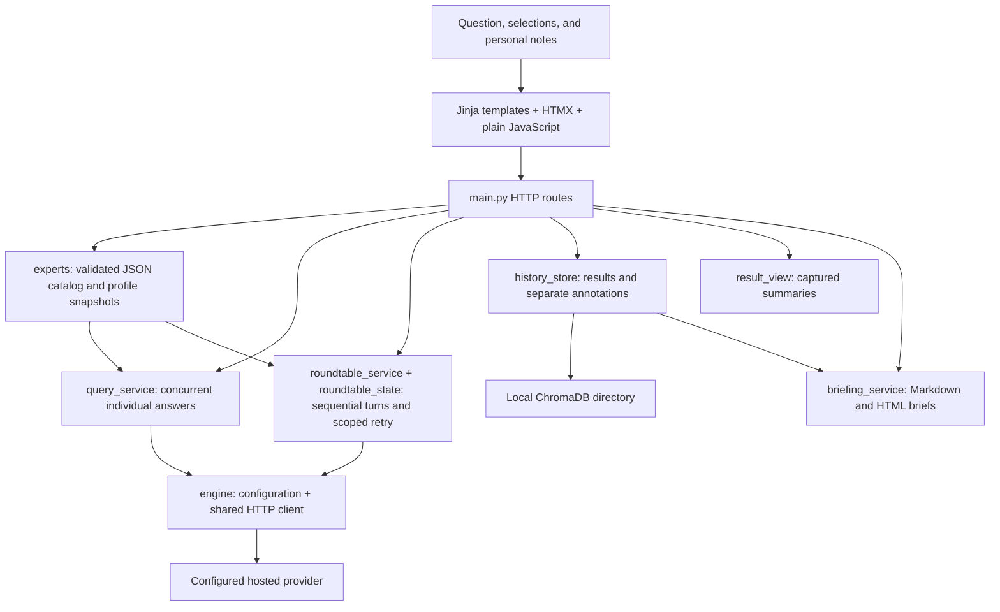

# AI Advisors: project review and harmony proposal

> Baseline review before the authorized repair patch. Findings, line references and test results describe that earlier state. See [Remediation status](REMEDIATION-STATUS.md) for prepared fixes and pending owner verification.

Review date: October 25, 2026. Reviewed checkout: `main` at `6e2a033071461731d0b3a0e826fc68f565937eae`.

AI Advisors is a useful local decision-support workbench with a sound basic stack. Its strongest features are configurable perspectives, preserved advisor profiles, scoped roundtable recovery, and a separation between generated advice and personal decisions. It needs corrections to saving, response validation, exports, and interruption recovery before its behavior supports a strong claim of professional reliability.

The recommended direction is an evidence-aware local workbench: frame a question, supply relevant context and sources, deliberately choose perspectives, preserve disagreement, produce a traceable result, record a personal decision, and resume easily. Professional quality here means dependable and useful to a professional. The current request does not establish a need for commercial infrastructure.

This report contains **24 correction and hardening items (F01–F24)** and **18 enhancement proposals (E01–E18)**. These are opportunities identified in the reviewed scope, not a claim that every possible defect has been found. They are grouped into a small number of implementation packages at the end.

## Read this first

1. [Current state and purpose](#current-state-and-purpose)
2. [Architecture and execution](#architecture-and-execution)
3. [Corrections with the greatest impact](#corrections-with-the-greatest-impact)
4. [Additional corrections and hardening](#additional-corrections-and-hardening)
5. [Professional workflow enhancements](#professional-workflow-enhancements)
6. [Documentation reconciliation](#documentation-reconciliation)
7. [Current Git changes](#current-git-changes)
8. [Verification evidence](#verification-evidence)
9. [Implementation sequence](#implementation-sequence)

## Mechanic's verdict

**MECHANIC'S VERDICT: FAIL ❌ against the requested professional-quality target.** The existing personal-use loop has recorded acceptance, and this verdict does not erase that observation. The failures below concern additional paths and the broader target of this review.

**INSPECTION LOG**

- [x] **No-Bloat:** the application uses Python, FastAPI, Jinja2, HTMX, ChromaDB, plain JavaScript, and CSS. There is no tracked application `package.json`, Docker configuration, frontend framework, account system, or microservice setup. Node is used for GitNexus and headless development tests; that distinction should be explicit in the policy.
- [x] **Arsenal:** no FastAPI or `main` imports were found in `lib/`. Provider calls, catalog handling, orchestration, persistence, and brief construction have separate modules. Import-time persistence and large mixed-purpose service files weaken portability and lifecycle control.
- [x] **Types:** a focused mypy run passed for five important source files. Runtime contracts still depend heavily on `dict[str, Any]`, and probes found values that satisfy current normalization while containing invalid content. Static typing does not close those gaps.
- [x] **Candlelight:** both stylesheet variable blocks contain the required palette. Some small muted text has insufficient contrast, and important document structure is lost by the Markdown sanitizer. Browser, assistive-technology, and print acceptance were not performed in this review.

**REQUIRED FIXES:** start with F01–F04, then durable recovery and deliberate request bounds in F05–F08. File and line evidence appears in each finding.

**REFACTOR SUGGESTION:** introduce one versioned result contract shared by save, replay, recovery, and export. Keep old-format conversion at a compatibility boundary. This removes repeated shape guessing and makes the most consequential behaviors reviewable without replacing the stack.

## Current state and purpose

### What the project actually is

The repository name preserves the agricultural origin, but the application, project metadata, and current README call it **AI Advisors**, version **2.1.0**. It now serves several kinds of decision support.

| Panel | Advisors | Default selection | Current role |
| --- | ---: | --- | --- |
| Agriculture | 10 | Agricultural Science Expert | Compare crop, climate, commodity, technology, supply-chain, soil, pest, water, organic, and economic perspectives. |
| Software | 5 | Architecture and Implementation | Examine supplied designs and code context from architecture, implementation, testing, security, and accessibility perspectives. |
| AI Workflow & Delegation | 4 | Workflow Designer and Delegation Planner | Produce a bounded task packet, review checklist, checkpoint, and success measure. |
| Accessibility & Effort | 4 | Voice-First Workflow Designer and Effort Reduction Advisor | Produce reusable starter text, a checkpoint, a dictation fallback, and a small trial. |
| Evidence & Judgment | 4 | Claim Examiner and Source Reviewer | Separate claims, support, assumptions, alternatives, and uncertainty in supplied material. |

There are **27 advisor definitions**, five panels, and 18 built-in example questions. They live in two JSON catalogs under `lib/experts/definitions/`. The catalog validates IDs, membership, defaults, and nonempty instructions. A custom panel can already reuse advisors from other subjects through JSON configuration.

All advisors use personas around the configured text-generation model. A separate synthesis model is optional. The software does not provide independent human experts, independent factual verification, live market/weather feeds, browsing, filesystem inspection, document retrieval, or execution of a proposed workflow. Its input is the supplied question and text; later roundtable turns also receive earlier successful contributions.

### What works today

| Capability | Implementation and practical limit |
| --- | --- |
| Individual answers | Selected advisors run concurrently. Failures are isolated into response entries. Individual failures do not have the roundtable's scoped retry interface. |
| Roundtable discussion | Advisors run sequentially across 1–5 rounds, then the moderator synthesizes successful contributions. The UI waits for the whole HTTP response. |
| Specialized results | Workflow and Accessibility panels have structured handoff formats. The three decision-support panels request compact Decision Checks. Prompt wording is not proof that a model follows the rules. |
| Recovery | Failed or pending roundtable slots and failed synthesis can be retried without regenerating successful slots. Shared-pool structured-synthesis failover is bounded. Recovery state is available after a response returns; it is not checkpointed to disk after every turn. |
| Historical profiles | Results capture the selected panel and advisor profiles before requests. Replay and export use captured profiles. Full request envelopes and complete per-call model receipts are absent. |
| Saving | Save creates a record in Chroma's `query_history`. Retrying a saved partial result creates a new unsaved result that can be saved separately. There is no explicit parent/version relationship. |
| Personal decisions | Optional title, status, next step, last step, blocker, and outcome live separately in `personal_annotations`. Note saves do not generate advice or rewrite the transcript. |
| Finding work | Case-insensitive search covers saved metadata and personal notes, including older records. Pagination shows ten results. Answer-body search is not implemented. |
| Resumption | A browser-local result ID restores the last opened/saved return point; explicitly Waiting or Undecided items can appear alongside it. Saved history remains available without browser storage. |
| Drafts and copy | The question draft and panel preferences use optional localStorage. Copy controls have a readable selected-text fallback. Personal-note drafts do not receive the same durable draft protection. |
| Exports | Markdown and HTML executive briefs use saved content without new provider calls. They are presentation transformations; they are not complete archival exports. |
| Operations | `./start.sh` starts a local uvicorn process from the checkout. Backup and restore are described manually. There is no unified local status/backup/recovery command. |

### Maturity assessment

- **Architecture:** a maintainable modular monolith with growing service-file complexity.
- **Personal workflow:** a useful implemented loop, with a recorded October 16 save/notes/search/resume acceptance observation.
- **Professional evidence quality:** incomplete. Persona output is not tied to a source ledger, claim-level support, or complete execution receipts.
- **Reliability:** good handling of returned partial roundtables; incomplete handling of interrupted requests, failed Save interactions, malformed saved payloads, and unsaved personal notes.
- **Documentation:** extensive, but contradictory and partly inherited from the former Node application.
- **Verification:** meaningful mocked behavioral coverage exists. The passing checks in this review do not establish live-provider adherence, browser behavior, assistive-technology usability, or disaster recovery.

## Architecture and execution

### Follow one request from start to finish

1. `main.py` renders all panel/advisor display metadata and sets the CSRF cookie. `panels.js` restores selections and the question draft when browser storage is available.
2. `/query` or `/roundtable` checks CSRF, validates the selected panel/roles, and captures advisor definitions. `/query` gathers advisor tasks concurrently. Roundtable execution constructs ordered role/round slots and fills them sequentially.
3. `Expert` assembles the user prompt. `LLMClient` sends it through an asynchronous HTTP client with a 120-second per-request timeout. The client presently returns text rather than an execution receipt.
4. Roundtable synthesis requests structured output. Selected schema/response failures permit text fallback. A confirmed upstream shared-pool 429 permits one same-model provider failover. Other failures retain successful contributions and require deliberate recovery.
5. The entire HTML result returns to the browser. The result and captured state are embedded in Save/retry controls. Until this response returns, there is no durable per-turn journal.
6. Save submits client-carried result JSON. `HistoryStore` writes a JSON document plus metadata. Personal notes are later saved to a separate collection.
7. History and Resume read existing records. Export transforms the saved result through `briefing_service`; it does not call a provider.

### Main maintenance pressure points

`main.py` is 633 lines, `roundtable_service.py` is 857 lines, and `briefing_service.py` is 1,460 lines. The latter contains current document construction, legacy Markdown interpretation, a specific historical investment-table parser, typography cleanup, and rendering. File size alone is not a defect, but the number of responsibilities makes changes harder to reason about.

Storage is instantiated at module import (`history_store.py:300`). Relative template/static paths and storage defaults depend on the working directory. Chroma calls are synchronous inside asynchronous routes. These are concrete lifecycle and responsiveness concerns; another framework or service layer is unnecessary to address them.

GitNexus's current index is bound to this exact repository and commit: **969 nodes, 2,263 relationships, 49 communities, 73 execution flows**, indexed October 25. Its status check reported matching content for all 78 covered files. The graph was queried for query/history/retry/export flows and inspected for `retry_roundtable` and `HistoryStore` dependencies. Text and source inspection supplemented the graph, including dynamic calls it cannot reliably resolve.

## Corrections with the greatest impact

Priority meanings: **P1** means address before making a strong professional-reliability claim; **P2** means substantial hardening or correctness work; **P3** means useful maintenance or convenience. No finding is presented as a demonstrated P0 exploit or an observed loss of Ryan's real data.

Effort meanings: **S** is a focused change, **M** crosses a few components, and **L** requires coordinated lifecycle or data-contract work. These are relative sizes, not time or cost commitments.

### F01 — P1 / S–M: a failed Save can remove the way to retry

**Evidence:** `templates/partials/responses.html:10` and `roundtable.html:14` send Save with an `outerHTML` swap targeting the whole result header. `main.py:565` returns only an error fragment on storage failure, with HTTP 200 and no alternate target. An isolated TestClient probe confirmed that response contains neither a Save control nor a preservation retarget header.

**Consequence:** the configured swap replaces the heading and Save button with an error. The transcript may remain readable, but the original Save request payload/control is gone. This makes a recoverable storage failure unnecessarily difficult to recover from.

**Proposal:** give Save its own status region and preserve the original header, state, and enabled retry action on failure. Return a meaningful failure status with an explicitly swappable preservation fragment. Add in-flight submission protection and the idempotency behavior in F16.

**Accept when:** an injected disk/storage error leaves the heading, transcript, captured state, and Save action available; a successful retry saves exactly one result and makes no provider request.

### F02 — P1 / M: unusable provider content can become successful advice

**Evidence:** `lib/engine/llm_client.py:90` returns `str(message['content'])`. MockTransport probes returned successful values of `"None"` for JSON null, an empty string for empty content, whitespace for blank content, and a Python list representation for text blocks. `Expert.query` only strips text. Roundtable's nonempty check cannot reject `"None"`. In `roundtable_service.py:668`, general structured fields are also converted with `str`; a null insight and null finding were accepted as a meaningful brief in a probe.

**Consequence:** missing or malformed output can be marked complete, saved, synthesized, and excluded from retry.

**Proposal:** normalize only supported response shapes; require usable nonempty text; handle explicit provider errors consistently in both client methods; preserve finish reasons and distinguish truncated output. Validate structured fields as their actual types rather than coercing null into prose. Keep a tolerant, explicit legacy reader separate from current provider validation.

**Accept when:** null, blank, malformed, error-envelope, and truncated responses receive explicit non-success states; supported text blocks normalize correctly; failed contributions remain retryable without touching successful ones.

**Change risk:** GitNexus rates `LLMClient.generate` **CRITICAL**, with four direct dependents and six affected flow entrypoints. Direct paths include standalone queries, discussion turns, synthesis fallback, and the environment helper. This is a shared boundary and needs focused downstream checks.

### F03 — P1 / M: Save accepts records that replay cannot render

**Evidence:** `main.py:511` and `:537` deserialize client JSON without a complete result contract. Advisor-context validation checks a separate subset. `HistoryStore.save_result` copies fields such as `transcript` without validating their types. An isolated probe used the actual serializer with an in-memory collection: a roundtable with numeric `transcript: 42` was reported as Saved; reopening that stored document returned HTTP 500.

**Consequence:** Save success does not guarantee that the record is usable. Other malformed values can reach summary, template, or export code.

**Proposal:** validate a versioned result envelope before any storage write. Validate response entries, role membership/order, transcript slots, synthesis fields, bounded strings, and result type. Validate stored data on read and distinguish unsupported/corrupt records from genuinely missing ones. Preserve legacy records through explicit adapters. Consider a server-owned result/run ID so ordinary Save does not need to resubmit the entire transcript.

**Accept when:** invalid payloads never mutate storage; every newly accepted result can replay and export; a legacy/corrupt record produces an actionable recovery message while other records remain available.

### F04 — P1 / M: the Markdown export can omit consequential content

**Evidence:** `/export/{id}` calls the brief renderer (`main.py:586`). Query briefs extract a first-block summary and at most three evidence points (`briefing_service.py:198`, `:1287`). `_clean_markdown_line` removes link URLs (`:1397`). The Markdown renderer does not include the original governing question as a separate exact-text field. A synthetic five-paragraph answer lost its final approval qualification and source URL; the original question's casing was also absent. Raw roundtable contributions are not included as a full transcript.

**Consequence:** a file labeled Export Markdown can appear to represent the saved answer while omitting a late restriction, context, or citation. This matters even when the brief is intentionally concise.

**Proposal:** distinguish **Export brief** from **Export complete record**. The complete export should preserve the exact question, responses/transcript, synthesis, status, captured definitions, and available execution metadata. Keep a concise brief, visibly label it as abridged, and preserve links and consequential limitations. Add a separate versioned JSON archive format through E09.

**Accept when:** sentinel qualifications, numbers, code, URLs, failures, and the exact original question survive complete export. Export makes no provider calls. A brief links or points to its complete source record.

### F05 — P1 / L: completed turns are not durable during a request

**Evidence:** `roundtable_service.py:247` mutates an in-memory state through sequential calls; `main.py:234` awaits the whole run before rendering. Persistence occurs only through the later Save action. There is no working-run journal or per-turn checkpoint.

**Consequence:** a process crash can discard completed provider work. A refresh or lost connection provides no supported way to reattach to an in-flight result. Returned partial-result recovery works, but it does not cover this earlier interruption window.

**Proposal:** create a server-owned working-run record before the first call and checkpoint every completed contribution and synthesis attempt. Use a separate working-run collection or journal so immutable saved results retain their meaning. An in-process task plus a small HTMX polling endpoint is sufficient initially; streaming is optional. Polling must read state without issuing model requests. Resume/retry remains deliberate.

**Accept when:** stopping the app after one checkpoint preserves that contribution; restart identifies unfinished work and offers a scoped action. A crash between provider completion and checkpoint must be labeled ambiguous, not promised as exactly-once execution or retried automatically.

### F06 — P1 / M: personal-note drafts can disappear during navigation

**Evidence:** `workspace.js:186` announces unsaved notes but does not preserve their draft values or guard navigation. The note form resides inside `#response`, which history, a new query, or retry can replace. `panels.js` persists only the question draft. In-flight note fields are correctly locked after serialization; that existing protection does not address unsaved navigation or reloads.

**Proposal:** retain a local draft keyed by result ID, visibly distinguish it from persisted notes, and protect replacement of a dirty result. Prefer a recoverable draft and a clear Save/discard choice over repeatedly interrupting routine navigation. If browser storage fails, keep the current text and provide a copy/recovery path. Do not silently mix drafts into exports or provider inputs.

**Accept when:** a dictated next step survives result switching and reload, a successful save clears only the matching saved draft, and an older response cannot overwrite newer dictation. Browser confirmation remains necessary for the actual input-method experience.

### F07 — P1 / M: request limits do not bound the work inside one run

**Evidence:** roundtables allow up to five rounds, with sequential calls for each selected advisor (`roundtable_service.py:247`). Every call includes earlier successful discussion text (`:256`). `LLMClient` has a 120-second per-call timeout but no explicit output-token cap or overall run deadline. Initial panel selections are bounded by the catalog, but retry-state validation permits as many as 64 roles with supplied profiles. Route requests-per-minute limits do not cap these internal calls.

**Consequence:** a 10-advisor, five-round selection means 50 contribution calls plus synthesis attempts. Repeated full-transcript input grows quadratically with the number of turns if contribution size stays similar. A single intentional click can create much more waiting and provider work than the user expects.

**Proposal:** show planned contribution/synthesis counts, default to a small deliberate run, cap output and overall work, and enforce a per-run deadline and a bounded retry allowance. Keep configured context limits explicit; reject or deliberately compact oversized context while preserving the full saved transcript. Add a pause action that stops scheduling new calls and checkpoints completed work. Label estimates separately from actual usage.

**Accept when:** a preflight identifies the planned calls; oversized input and excessive plans are rejected before dispatch; pause and deadline exhaustion preserve state and schedule no further calls. No live prices need to be hardcoded.

### F08 — P2 / M: saving history unexpectedly depends on an embedding model

**Evidence:** the history collection is created without overriding Chroma's default embedding function (`history_store.py:52`); Save adds documents without explicit embeddings (`:121`). The installed Chroma 1.4.1 defaults to `DefaultEmbeddingFunction`. A probe made that embedding function fail: Save invoked it once and persisted zero records. The installed ONNX implementation downloads its model when its cache is absent. The application's history search reads metadata rather than performing vector retrieval.

**Consequence:** a basic Save can depend on embedding-model availability, download access, and inference work that the user does not need for current history search. Warm-cache tests do not establish first-save behavior on a clean machine.

**Proposal:** keep mandated ChromaDB, but make nonsemantic record persistence independent of model inference. Design an explicit no-embedding or inert-embedding strategy for the appropriate collection, preserving existing dimensions/configuration and records. Test compatibility before changing an existing collection; use a new collection and a deliberate additive migration if required.

**Accept when:** new and existing-installation Save paths work without an embedding download or embedding inference, and legacy records remain readable. A migration needs a backup and isolated restore check first.

### F09 — P2 / M: profile snapshots are not execution receipts

**Evidence:** snapshots contain advisor definitions (`catalog.py:87`); runtime adds or removes discussion instructions (`base.py:79`). The synthesis model label is stored, but advisor model IDs, actual provider/request IDs, parameters, finish reasons, token usage, and complete prompt/rule versions are not recorded per call. Client-submitted snapshots are shape-checked, not authenticated as provenance; existing architecture documentation acknowledges this.

**Proposal:** capture a minimal per-call receipt: configured model, returned model/provider when available, request/generation ID, start/end times, usage if supplied, finish reason, prompt/rule version, and input reference. Store unknowns honestly. Use server-owned run/result records; retain an explicit legacy/unknown label for old saves. Detailed prompt archives can be optional private data rather than routine logs.

**Accept when:** a saved result identifies how each contribution was produced and which rules a retry used; changing `.env` or the catalog cannot silently relabel historical work. Do not promise reproducible wording from a nondeterministic model.

### F10 — P2 / S initially: exported Sources are personas, not supporting evidence

**Evidence:** `briefing_service.py:292`, `:411`, and `:534` populate sources with advisor/speaker labels. The general synthesis schema has generated `evidence_points` without source IDs. The UI already warns that persona agreement is not verification, but the standalone export does not consistently carry an equally explicit explanation.

**Proposal:** immediately label these entries **AI participants / generated inputs**, carry the AI-origin and verification limits into both exports, and stop presenting persona agreement as evidentiary support. E03 can then add actual supplied source records and claim-to-source references.

**Accept when:** an exported brief makes it clear which text is generated, which sources were actually supplied, and which consequential claims remain unverified. An advisor's name is never represented as an independent citation.

## Additional corrections and hardening

| ID | Priority / size | Evidence and problem | Solution proposal | Acceptance condition |
| --- | --- | --- | --- | --- |
| F11 | P2 / M | `templates/base.html:8` loads HTMX, Marked, and DOMPurify from public CDNs; Marked is unversioned. The application depends on them for core interaction. A missing `marked` also interrupts the inline initialization before its later listeners register. | Vendor reviewed, pinned browser assets locally with license notices. Add a visible dependency/init failure path; do not require an npm build. Track external asset versions alongside Python dependencies. | Core page, notes, history, and Markdown rendering work when CDNs are blocked; unexpected script initialization failures produce readable guidance. No claim about a specific advisory is made by this source review. |
| F12 | P2 / M | Invalid CSRF, empty input, and many exceptions return HTTP 200; some invalid panel requests return 400 without an opted-in HTMX swap. Framework validation and rate-limit handlers can return JSON although `API.md:36` describes HTML errors. | Define a small error contract covering status, message, retryability, and preservation target. Render it consistently for form validation, exceptions, CSRF, and 429s. Keep a result-preserving status region. | Each failed operation presents an actionable error and truthful status while retaining input and completed work. Focused HTMX integration checks exercise 400/403/422/429/503. |
| F13 | P2 / S | The ordinary start command uses uvicorn's loopback default, but `main.py:633` binds `0.0.0.0` when executed directly. History/export routes have no authentication. | Make every supported launcher explicitly bind loopback. Keep any future network exposure an explicit separate mode with a proportionate reviewed boundary. | Both documented and direct entrypoints remain local by default. No accounts or OAuth are needed for this correction. |
| F14 | P2 / M | `start.sh:9` uses the caller's current directory, sources `.env` as shell code, and starts unlocked `uv run`; static/templates and default storage are also relative. `config.py:44` validates only a missing key. A probe accepted blank URL/model and port zero. | Anchor paths to the project/application root, load dotenv once through Python, quote arguments, use the intended locked environment, and validate URL/model/port/placeholders before dispatch. Retain the history directory explicitly when changing path resolution. | A short alias invoking the launcher from another directory finds the same configuration and history; malformed settings yield one actionable diagnostic without provider calls or accidental new storage. |
| F15 | P2 / M | `HistoryStore.get_history` scans every record's metadata and annotations before sorting/paging. Resume performs another unfinished-item scan. Synchronous Chroma reads, writes, and potentially embeddings run inside async routes. | Move blocking store work off the event loop through a small adapter. Measure a realistic local fixture, then add a simple ordered metadata index or bounded cache invalidated on saves/notes if needed. Keep all-history discovery correct. | A slow Save/history operation does not stall independent status or page requests. Search still finds older matches and keeps stable pagination. State clearly that current scans are metadata-only, not whole-document reads. |
| F16 | P2 / M | `history_store.py:79` reduces UUIDs to eight hexadecimal characters, with no collision strategy. Save controls have no submission lock/idempotency token. Retried saves have no lineage. `workspace.js:4` only accepts eight-character IDs. | Use full internal IDs for new records, retain short display codes, and accept existing IDs. Add Save idempotency keyed to the generated result/version and explicit `parent_result_id` for deliberate recovered versions. | Double activation or a lost Save response produces one logical record; injected collisions cannot alias another answer; all existing short IDs and Resume preferences still work. |
| F17 | P2 / M | Agriculture prompts describe monitoring current markets, forecasting weather, diagnosing pests, and compliance guidance (`advisors.json:11`, `:17`, `:41`, `:53`), although the app has no corresponding live data or field access. Existing generic limitations and safer examples help but do not fully align the capability claims. | Make every role explicit about supplied evidence, location, date, units, and missing measurements. Request the minimum decision-relevant context before a consequential recommendation. Treat local standards and current data as supplied/unchecked unless a deliberate source is available. | Scenario checks reject invented current facts, unsupported diagnosis, treatment rates, and compliance claims; they produce conditional advice and concrete missing-evidence checks. No substantive agricultural recommendation is made by this report. |
| F18 | P2 / S–M | README, release notes, the month plan, completion state, and review disagree on scope/version/acceptance. CONTRIBUTING is still the Node/Ollama/MongoDB guide. Details are reconciled below. | Establish one current status/evidence table, archive historical reports with explicit scope, and replace obsolete contribution/setup guidance. Derive role counts from the catalog rather than copying them. | A returning reader finds one current setup path, one current project purpose, and dated evidence with separate automation, personal, and live-output observations. |
| F19 | P2 / M | Backup/restore is a manual instruction referencing a historical private snapshot; no maintained helper or restore rehearsal is represented in the application/tests. Its present recoverability was not inspected. | Add one local backup/export command that records source/configuration/storage versions and excludes secrets from shareable bundles. Restore into a fresh location first and verify documents plus annotations; preserve current data before any replacement. | A temporary backup/restore exercise retains exact generated records and personal notes. The tool states which drafts remain browser-local and which data is included. |
| F20 | P2 / M–L | Current schemas, normalization, prompt assembly, legacy parsing, and rendering overlap across large service modules. General consensus fields are permissively coerced while handoff fields have stronger checks. | Centralize versioned data types and validation; split legacy brief interpretation from current rendering and synthesis schemas from execution. Keep provider calls out of export. Preserve compatibility fixtures instead of deleting old readers. | Existing saved formats still replay/export, current invalid formats fail at the boundary, and each module has one clear responsibility. Apply graph impact checks before moving or changing symbols. |
| F21 | P2 / S–M | `history_store.py:127` logs question text. `verify_env.py:22` prints key fragments; the helper sends a live request by default, returns normally on failures, and does not close its client. Routes expose raw exception details through the error partial. | Log IDs, operation, duration, and classified failures without user content or key fragments. Add an offline diagnostic default, an explicit bounded live option, correct exit codes, and `finally` cleanup. Show safe details in UI and correlate with a local error ID. | Diagnostics contain no submitted question or key substring; offline checks make no request; failure exits nonzero; clients close. |
| F22 | P2 / M | Small history-type and brief metadata/metric text uses muted gray. Calculated contrast is 3.88:1 on `#121212`, 3.60:1 on `#1A1A1A`, and 3.21:1 on `#242424`. `base.html:28` drops Markdown table tags. `workspace.js:139` updates a polite live region every second. Advisor checkboxes retain small targets; note Save replaces its focused form. | Use `--text-2` for meaningful small text, preserve semantic table tags with safe sanitization, enlarge the entire selectable row, separate visual elapsed time from milestone announcements, and deliberately restore focus after note swaps. Preserve the Candlelight palette. | Static contrast checks meet the chosen text requirement, table relationships survive rendering, and one authorized keyboard/dictation/assistive-technology pass confirms the changed interactions. The ratios are calculations; actual screen-reader disruption is a risk to test, not an observed result. |
| F23 | P2 / M | Headless controller tests use stubbed DOM/events, and route tests inspect returned HTML. Neither automatically exercises actual HTMX outerHTML swapping, browser dependencies, dirty-note navigation, or print layout. | Add a small deterministic local integration fixture for Save failure, dirty-note navigation, response swapping, and complete export. Use a real browser only in a focused pass authorized by Ryan. Keep model-quality trials separate from UI checks. | The tests would fail on F01/F06 and verify the repaired interactions. A later browser check records actual scope rather than inheriting historical acceptance. |
| F24 | P3 / S–M | `CLAUDE.md:26` still describes ten expert classes; `:80` forbids client-side state despite the implemented preference/draft controllers. It has a second review format, old setup commands, and broader test guidance. `response_card.html` duplicates unused response markup, and the two CSS variable blocks duplicate the palette. | Align agent instructions with current contracts and Ryan's targeted-check/owner-controlled Git policy. State that Node is development tooling. Remove dead markup only after reference/impact confirmation; centralize shared theme variables if the benefit exceeds the extra coupling. | Agents receive a consistent operating model, existing user changes remain preserved, and cleanup does not change rendered behavior or require a frontend build. |

## Professional workflow enhancements

These are proposals, not implemented features or release gates for the existing personal tool. An enhancement should earn its maintenance through a concrete task. Several build on the corrective contracts above.

| ID | Proposal and benefit | Smallest useful implementation | Accept when / dependency |
| --- | --- | --- | --- |
| E01 | **A compact task brief.** Better input creates more specific advice with less re-explanation. | Optional goal, decision, constraints, location/date where relevant, evidence, and desired deliverable. Keep one free-text route and reusable defaults. | A recurring task can be started without redictating stable background; unknowns are explicit. Depends on F03/F17. |
| E02 | **Reusable personal context.** Capture capacity and project constraints once. | A local named context snippet that is selected deliberately, previewed, and snapshotted into the run. Exclude personal notes and sensitive context by default unless selected. | The run shows exactly what context will be sent; editing the template does not change an old result. |
| E03 | **A source ledger.** Give evidence a stable identity. | Source cards containing a short label, supplied excerpt, date, reference, and local source ID. A pasted URL remains a reference until its content is supplied. | Each cited source can show the exact supplied passage; invented source IDs are rejected. Builds on F10. |
| E04 | **An options matrix.** Make tradeoffs inspectable. | User-specified options and criteria, with source-linked reasons, assumptions, unknowns, and reversible next checks. Avoid unexplained aggregate scores. | A reader can see why an option changes when a constraint changes. No fabricated quantitative precision. |
| E05 | **A disagreement view.** Preserve the second advisor's actual contribution. | Separate supported agreements, unresolved differences, and what observation would resolve each difference. Attribute each point to captured turns. | A synthesis can retain a consequential minority view rather than smoothing it into consensus. |
| E06 | **A deliberate follow-up action.** Avoid reconstructing saved context. | “Ask a follow-up” starts a new linked run with a preview of selected original context and the new question. Add scoped retry for failed standalone answers. | Successful original answers stay immutable; new provider calls and carried data are explicit. Depends on F03/F05/F09/F16. |
| E07 | **Personal starter management.** Reuse successful questions without editing JSON. | A small local saved-starter collection with name, panel, role choices, and editable placeholders; retain built-in examples unchanged. | One short selection starts a recurring task; malformed edits cannot break the built-in catalog. |
| E08 | **A shareable decision report.** Include the user's conclusion when wanted. | A new report view that combines selected generated material with explicitly labeled personal decision/outcome fields. Preview inclusion choices. Keep existing exports' historical behavior stable. | Generated recommendations and user decisions remain distinguishable, and omitted private fields stay omitted. |
| E09 | **Portable complete records.** Make work independent of one database directory. | Versioned JSON plus complete Markdown; a bounded import preview checks IDs/schema and reports duplicates before additive import. Keep credentials out of this format. | A temporary export/import round trip preserves exact content, profile snapshots, relationships, and selected annotations. Depends on F03/F04/F19. |
| E10 | **Useful organization.** Reduce time finding a result. | Optional panel/status filters, date range, a few tags, pinned work, and reversible archive. Keep full metadata search. Treat permanent deletion as a separate explicit operation. | An older known item is easy to find and an archived item is recoverable without calling a model. |
| E11 | **A controlled comparison view.** Make model or prompt experiments reviewable. | Compare two deliberately selected runs using input references, model receipts, outputs, disagreements, and user evaluation. Do not automatically rerun a bank of prompts. | A comparison distinguishes changed inputs/rules/models and does not imply independence or a fair benchmark without controls. |
| E12 | **Outcome-based learning.** Retain what actually helped. | Build on existing outcome notes with optional Helped / Needed correction / Not tried categories and a short reason. Offer a user-selected past example as context for a new run. | No generated answer marks itself successful; later use is grounded in the user's recorded experience. |
| E13 | **Deterministic calculations where useful.** Keep arithmetic inspectable. | A few task-specific Python calculations with explicit units, input assumptions, formulas, and sensitivity ranges, introduced only for recurring real tasks. | Results agree with known fixtures and identify missing inputs. The LLM does not become the arithmetic authority. |
| E14 | **Bounded document excerpts.** Reduce manual context transfer. | Start with local text/Markdown excerpt selection and a strict size limit. Preview exactly what will be sent. Add other formats only when use justifies extraction upkeep. | Selection preserves source identity, code/units, and omissions. Imported document instructions remain untrusted content, not execution instructions. |
| E15 | **Transparent per-run model controls.** Make provider choice deliberate. | Display configured advisor/synthesis models, planned call counts, bounded output settings, and actual returned usage when available. A small per-run override can follow only if needed. | Unknown cost/usage is labeled unknown, no price is fabricated, and a model setting cannot silently relabel saved history. Depends on F07/F09. |
| E16 | **Low-effort local operation.** Match Ryan's actual input needs. | One short command or launcher with start/status/stop, offline doctor, and backup entrypoints. Add discoverable shortcuts for focus-question, save, search, and resume after an accessible interaction review. | The agreed alias works from any directory, recovers an interrupted session, and needs minimal repeated input. A generated suggestion never claims that a voice command was installed. |
| E17 | **A small quality pack.** Define exceptional results through observable behavior. | Fixed fictional cases for missing evidence, source contradiction, unconfirmed tools, incomplete output, irrelevant advisors, and unsafe certainty. Run structural checks offline; run live cases only with a deliberate call budget. | The rubric assesses support, usefulness, disagreement, uncertainty, effort, and recovery separately from prompt wording and test pass counts. |
| E18 | **Stable local bookmarks and return links.** Resume a known task directly. | A full-page saved-work route or validated query parameter that opens a result and notes, with a human-readable title and missing-record fallback. Preserve fragment routes for HTMX. | A local bookmark reopens the intended result without a provider request or remembered sidebar state. |

### What makes this exceptional

The distinguishing value is dependable decision work with low effort: a useful question, visible evidence, attributable perspectives, a result that preserves restrictions, a user-owned decision, and a clear return point. Additional personas alone will not provide that.

Keep the existing five panels. Improve their output contracts before expanding the catalog. Start with structured excerpts rather than an ingestion platform. Keep deliberate APIs when they serve the task. The reviewed code does not justify a multi-user platform, a task queue service, an autonomous agent framework, or a frontend rebuild.

## Documentation reconciliation

| Document | Current mismatch | Proposed treatment |
| --- | --- | --- |
| `README.md:7` and `:9` | Says browser/dictation/return acceptance remain open and shipping acceptance is on hold. | Replace broad current-status prose with a dated table. Acknowledge the recorded October 16 save/notes/search/reload-resume observation; keep unperformed input-method and live-output checks separate. |
| `docs/RELEASE-READINESS.md:7` versus `:20` | The same October 16 section says personal acceptance verified and then says it is the next open step. | Keep the observation and its scope; remove the conflicting present-tense statement. Preserve October 15's failed trial as historical evidence. |
| `docs/MONTH-PLAN.md:331`, `:348`, `:359` | Records acceptance and claims all 30 days complete, while several earlier personal-observation checkboxes remain unchecked. | Mark the bounded loop accepted, list individual unobserved checks honestly, and stop equating implementation completion with every possible acceptance activity. An immediate refresh supports reload resumption; do not broaden it into a measured after-break study without evidence. |
| `docs/PERSONAL-USE-CHECK.md:49` and `:51` | Still says no browser acceptance pass ran and personal acceptance is next, despite the newer recorded observation elsewhere. | Distinguish the earlier engineering check from the later owner observation. Make the checklist reusable without presenting it as a new mandatory trial. |
| `ROADMAP.md:17` and `CHANGELOG.md:13` | Carry remaining-acceptance language that is not reconciled with later records. | Link the current evidence table, keep historical entries dated, and use this review's new scope as a separate improvement backlog. |
| `COMPLETION_STATE.md:3` | Presents a completed 2.0.0 state dated April 1 as current. | Archive or prominently label the historical scope. Do not overwrite its old test result with a new count. |
| `review.md:3` | April 1 review describes ten advisors and says remaining work is enhancement only. | Mark historical and link this review. Its earlier bounded verdict cannot establish current professional readiness. |
| `CONTRIBUTING.md:39`, `:285`, `:404` | Node/npm/Ollama/MongoDB instructions, old file paths, and “test infrastructure coming soon” contradict the Python implementation and existing tests. | Replace with a concise Python/uv guide, JSON catalog instructions, targeted checks, and explicit owner-controlled Git actions. |
| `CLAUDE.md:18`, `:26`, `:80` | Setup can overwrite `.env`, the file map describes old subclasses, and the state rule contradicts current plain-JS behavior. | Preserve existing `.env`, describe the catalog and controllers, and align the source-check protocol. |
| `.cyborg-docs-notes.md:25` and `:40` | Local sync source still describes ten agriculture-only advisors and an agriculture-only project frame. | Update this local source when documentation reconciliation is authorized. Any cross-project sync needs the canonical Cyborg manual and a separately bounded change; this review did not run a sync. |
| `docs/UPDATE-IDEAS.md:3` | It is correctly labeled historical, but its body still lists now-implemented search/recovery/catalog work and outdated resilience claims. | Retain as an archive; use this dated report as the current proposal list rather than treating old brainstorming as requirements. |
| `API.md` | Most current fields are documented, but the overview's universal HTML-error promise does not match validation/rate-limit behavior. | Update alongside F12, including status/swap rules, current payload limits, and archive versus brief export semantics. |

The existing relative Markdown file-link scan found no unresolved file destinations. The principal documentation problem is factual and procedural drift, not broken local filenames. External links were not checked.

## Current Git changes

### Starting state

- Branch: `main`, HEAD `6e2a033`, last commit October 16, 2026: `docs: record personal acceptance verification and complete 30-day work plan`.
- The cached `origin/main` reference and `main` had zero commits on either side. No fetch was performed, so this is not a claim about the remote's live state.
- Two unstaged files were modified: `AGENTS.md` and `CLAUDE.md`. There were no staged changes and no untracked files at the initial inventory.
- Each file had five inserted lines and one replaced line: ten additions and two deletions in total.

### Deep review of the actual patch

1. Both files add the same **Source change checks** section. It requires tracing imports, callers, routes, templates, and focused tests before edits, keeping unknowns explicit, and leaving staging/commits/push/deploy/publication under Ryan's control.
2. Both replace the older generated graph summary, **607 symbols / 1,235 relationships / 41 flows**, with **969 / 2,263 / 73**. Those new counts match the current index metadata and CLI status.
3. Neither hunk changes runtime code, dependencies, catalog content, schema, templates, styles, or saved data. Native source tracing and graph-first inspection can both be satisfied; the added paragraph does not explicitly remove the surrounding GitNexus requirements.
4. GitNexus `detect-changes --scope all --repo .` classified the patch as **two files, four documentation sections, zero affected execution processes, low risk**. Manual inspection confirms the patch's actual scope. `git diff --check` passed.
5. No concrete defect was found in these added hunks. Existing conflicting/stale policy elsewhere in `CLAUDE.md` remains F24; it was not introduced by this patch. The generated numbers are a snapshot and will require regeneration after future changes.

The two original modifications were preserved. This review adds only this report; application source and the original instruction-file patches are unchanged. Nothing was staged, committed, pushed, deployed, or published.

## Verification evidence

### Checks performed for this review

| Check | October 25 result | What it establishes |
| --- | --- | --- |
| Focused Python regression | **58 passed in 2.69 seconds** across `test_llm_client.py`, `test_workspace_routes.py`, `test_roundtable_retry.py`, and `test_briefing_service.py`. | The selected existing mocked behaviors pass in the installed project environment. Storage was redirected to temporary directories before imports. |
| Headless JavaScript | **12 passed** in `test_workspace_controls.cjs`. | Controller behavior under the test's stubbed DOM/event model. This is not actual HTMX/browser acceptance. |
| Focused typing | **No issues in five files:** config, LLM client, history store, roundtable state, and result view. | The selected current static annotations pass mypy with imported modules followed silently. This is not a project-wide typing claim. |
| Syntax/boundaries | **21 Python sources parsed**; no `lib/` imports of `main` or FastAPI found. | Syntax under installed Python 3.13.1 and the inspected framework boundary. Python 3.12 and other platforms were not executed. |
| Local documentation links | **No unresolved relative file links** among root and `docs/` Markdown. | File destinations exist. Anchor semantics, external targets, and truth of prose were not verified by this check. |
| Theme calculations | Muted text contrast **3.88 / 3.60 / 3.21** on the three mandated dark surfaces. | Calculated contrast for those solid-color pairs; rendered gradients, device viewing, and personal reading experience were not measured. |
| Git/source state | Instruction patch reviewed; whitespace check passed; current graph matched covered files. | Dated local source/diff evidence, not publication or release approval. |

Tests used the existing `.venv` directly. Relevant installed versions included Python 3.13.1, FastAPI 0.128.0, ChromaDB 1.4.1, HTTPX 0.28.1, and Jinja2 3.1.6. No dependency installation or lockfile refresh was performed. Today's results are not described as a fresh locked-environment synchronization.

### Isolated probes of uncovered behavior

All probe questions/answers were synthetic. Provider calls used MockTransport. Save/replay probes used temporary or in-memory stores. No real `.chromadb` records were opened by the application, no private `.env` values were printed, and no live model request was made.

| Probe | Observed result | Related item |
| --- | --- | --- |
| Plain-text content null, empty, whitespace, or text blocks | Accepted as `"None"`, blank/whitespace, or a Python list representation. | F02 |
| Structured null insight/finding | Normalized into literal `"None"` values and accepted as meaningful. | F02 |
| Five-paragraph query export with a final qualification and source link | Final qualification, source URL, and exact original question were absent from the brief Markdown. Persona appeared under Sources. | F04/F10 |
| Simulated storage exception during Save | HTTP 200 error fragment, without a Save retry control or a preservation retarget. | F01/F12 |
| Numeric roundtable transcript sent to Save | Save reported success; reopening the captured stored document returned HTTP 500. | F03 |
| Embedding function forced to fail | History Save invoked the default embedding function and persisted zero records. | F08 |
| Blank provider URL/model and port zero passed to Settings | Current `validate()` accepted them with a nonempty placeholder key. | F14 |

### Existing historical evidence

Repository documents record **182 full-suite tests passed in 4.14 seconds on October 16**, and a bounded owner trial of personal notes, search, and resume. Those are dated recorded results, not new executions in this review. The documents also preserve an October 15 live output failure and its later prompt/UI corrections. No current live adherence claim is inferred from prompt changes or mocked tests.

The review did not run the full suite, reindex GitNexus, launch a browser, perform a screen-reader/dictation trial, contact a live model, rehearse production restore, inspect private saved advice, or verify a public deployment. The project runner initially attempted an unavailable npm registry fallback; using the already-installed local GitNexus CLI then completed graph inspection without installation or reindexing.

## Implementation sequence

### Package 1: make the existing result loop trustworthy

Implement F01–F04 and the relevant F12 error handling together around the versioned result contract. Include null/blank provider replies, malformed Save payloads, a failed Save followed by retry, and lossless export sentinels in focused regressions. Preserve existing legacy examples.

**Completion gate:** every accepted result can save, reopen, and export completely; every failed Save preserves a usable recovery action; unusable provider output is never marked successful advice.

### Package 2: make interruption and spending recoverable

Implement F05–F08, F16, and F19. Keep working-run checkpoints separate from immutable saved results. Add simple per-run work bounds and manual pause/resume. Include first-save behavior with an empty embedding cache and an isolated backup/restore exercise.

**Completion gate:** a stopped process does not erase checkpointed contributions, an ambiguous in-flight call is visible, and the next action cannot silently repeat successful paid work. A basic Save works without an embedding model dependency.

### Package 3: make professional claims traceable

Implement F09/F10/F17 and E01/E03. Capture execution receipts and explicitly supplied source excerpts. Strengthen capability grounding in Agriculture as well as the newer decision panels. Treat agreement as generated analysis, not independent corroboration.

**Completion gate:** a brief distinguishes supplied facts, generated inference, unresolved disagreement, and missing evidence; each material source reference points to actual captured input.

### Package 4: make daily operation low effort

Implement the launcher/configuration and local-binding work in F13/F14, blocking-I/O improvements in F15, private diagnostics in F21, and the accessibility work in F22. Vendor browser dependencies through F11. Reconcile current documentation and agent instructions through F18/F24.

**Completion gate:** the agreed short entrypoint starts the correct local installation from any directory, reports configuration failures clearly, and resumes a known item with its saved next action. Obtain one focused browser/personal observation only for the changed interactions, when authorized.

### Package 5: add only enhancements that improve a real task

Choose from E02 and E04–E18 using recorded friction. The strongest early candidates are a source-backed options/disagreement view, deliberate follow-ups, user-selected report exports, stable local return links, and a small quality pack. More panels, semantic retrieval, model comparisons, and document formats can wait for a recurring need.

**Completion gate:** the feature reduces repeated context entry, review effort, recovery effort, or missing evidence on one concrete task. Keep a measurable observation separate from an attractive interface or model self-assessment.

### Verification and review discipline for follow-up work

Trace affected source paths and use GitNexus impact before editing symbols. Its critical rating for the shared provider client must remain visible. Introduce focused tests for the actual repaired behavior; do not rerun the whole suite after each small change. After an accumulated implementation warrants a full suite, give Ryan the command to run locally and record the result for that exact revision. Use a private stopped-app backup before changing persistence behavior. Keep staging, commits, pushes, deployment, and publication under explicit owner delegation.

**Recommended first action:** one bounded repair pass for F01–F04. It addresses demonstrated correctness gaps and establishes the result contract needed by the later recovery and evidence work.
