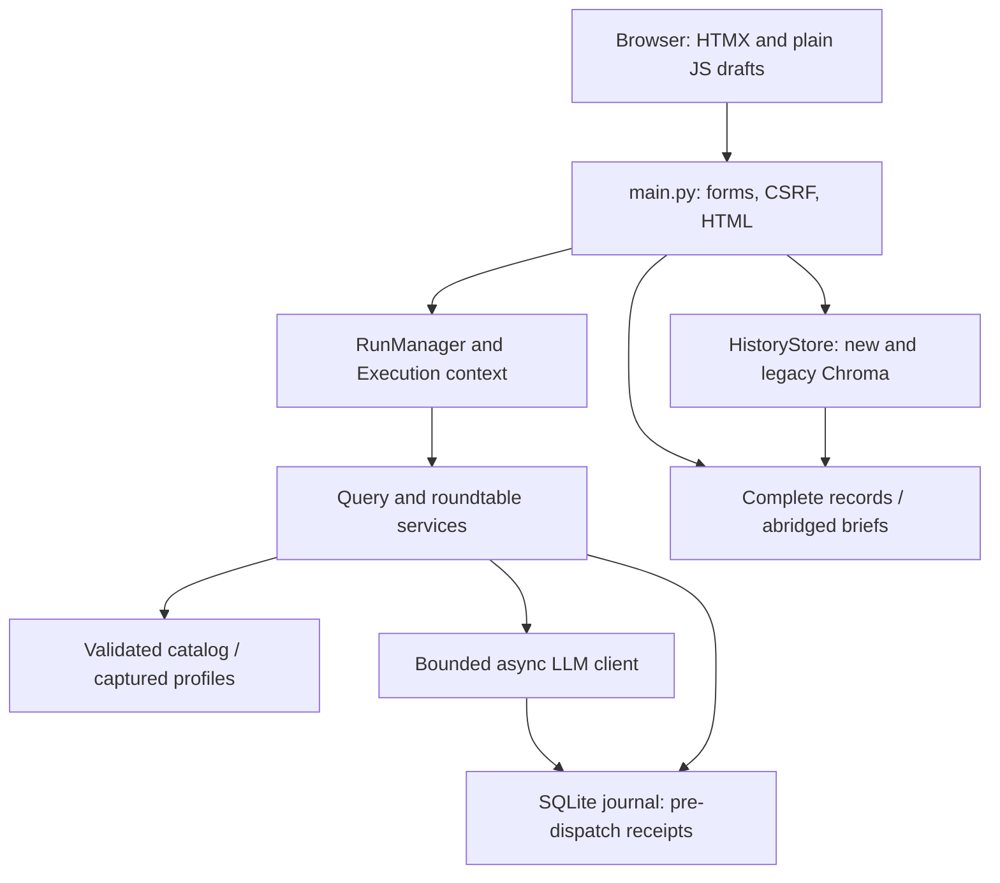

# Architecture and boundaries

Current repair source: October 25, 2026; verification pending. One local Python application, one browser, one user. No separate queue service or frontend build.

| Boundary | Owning source / contract |
| --- | --- |
| HTTP and UI mapping | `main.py`: validate forms/CSRF, safe errors, response targets. Blocking storage runs through `asyncio.to_thread`. |
| Data shapes | `lib/contracts.py`: bounded versioned results, source/task context, JSON-schema subset. |
| Deliberate execution | `lib/services/run_service.py`, `lib/engine/execution.py`: create/checkpoint/pause/manual resume, budgets and uncertain work. |
| Provider | `lib/engine/llm_client.py`: bounded dispatch, usable output, strict schemas, private receipts and limited same-model shared-pool failover. |
| Advisor behavior | `lib/experts/`: validated catalog, current/captured instructions and shared response formats. |
| Orchestration | `lib/services/query_service.py`, `roundtable_service.py`, `roundtable_state.py`: preserve successes and distinguish partial synthesis. |
| Persistence | `lib/storage/history_store.py`, `workspace_store.py`: immutable generated saves, separate notes, working journal/assets/organization. |
| Export | `record_export.py`: lossless Markdown/JSON; `briefing_service.py`: abridged presentation; `brief_models.py`: data; `brief_compat.py`: legacy parsing only. |
| Local operation | `lib/operations.py`: verified process identity, offline doctor, private stopped backup/new-location restore, owner-invoked checks. |

`lib/` never imports `main.py` or FastAPI. Services can be called without HTTP. They accept plain data; storage does not render UI and export does not call providers. Explicit optional execution context supplies checkpoints/receipts to existing service APIs. The process manager lives in FastAPI lifespan state and closes its tasks at shutdown; the provider client is closed too.

Captured profiles identify historical advisor definitions. Request receipts fingerprint effective messages and identify the rule version/model metadata; they are not a verbatim complete HTTP archive or an authenticated claim of independent verification. Saved replay and exports never regenerate advice. A deliberate retry uses captured profiles with current orchestration rules and preserves successful text.

Supported data shapes fail at their boundary rather than breaking a later render. Templates perform display decisions, not external effects. Browser drafts supplement application saves and are never the source of authoritative generated records. The broad portable-core dependency graph and changed integration still require the owner regression gate.
